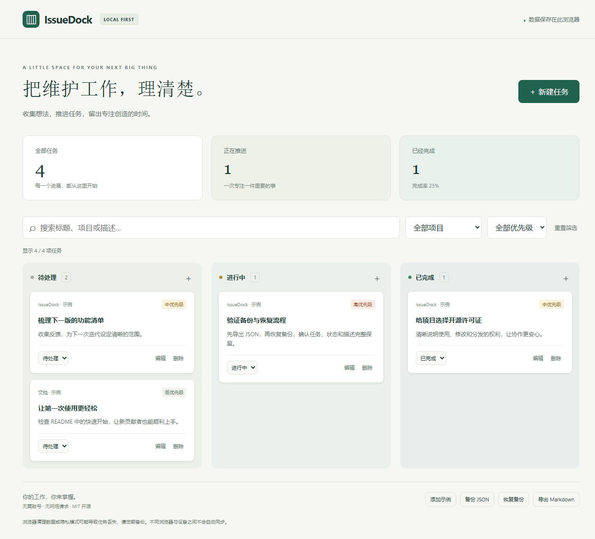

# IssueDock

[](https://github.com/strongnainai/issuedock/actions/workflows/test.yml)

**把维护工作，理清楚。**

IssueDock 是一个轻量、离线优先、无需账号的项目任务看板。它把日常维护任务保存在自己的浏览器里，不依赖后端、分析服务或第三方运行时依赖。

> IssueDock is a zero-dependency, local-first task board for independent maintainers. It runs from static files, stores data in the browser, and exports portable JSON or Markdown.



## 为什么做这个

独立维护者经常在代码仓库、Issue、聊天记录和临时笔记之间切换。IssueDock 只解决一个小问题：给尚未进入 Issue 跟踪器的维护任务一个清晰、私密、不会被云服务锁定的位置。

它适合：

- 个人维护开源项目、整理发布前工作或记录后续想法；
- 希望任务数据只留在本机浏览器中；
- 需要快速备份、迁移和用纯文本检查数据；
- 偏好小代码库、无构建步骤和易审查实现的贡献者。

它不试图替代 GitHub Issues、团队项目管理或多人实时协作，也不会自动同步 GitHub。

## 快速开始

下载本仓库并双击 `index.html`，即可在最新版 Chrome、Edge 或 Firefox 中使用。需要启用 JavaScript。

也可以启动一个本地静态服务器：

```sh
python -m http.server 4173 --bind 127.0.0.1
```

打开 <http://localhost:4173>。无需 `npm install`，应用没有后端、构建步骤或运行时依赖。

点击“添加示例”可以体验看板；示例不会自动写入新用户的数据。长期使用时建议固定同一个本地地址，因为 `localStorage` 按来源隔离。

## 能做什么

- 新建、编辑和删除任务，记录项目、描述与优先级。
- 按“待处理 / 进行中 / 已完成”整理工作，并直接切换状态。
- 按标题、项目或描述搜索，同时组合项目和优先级筛选。
- 查看任务总数、进行中数量和完成率。
- 导出 JSON 备份并恢复，或导出按状态分组的 Markdown 清单。
- 响应式布局支持窄至 320px 的屏幕、键盘操作、明确焦点和减少动态效果偏好。
- 无外部 CDN、遥测、分析脚本或未声明的网络请求。

## 数据与隐私

数据只保存在当前浏览器的 `localStorage`，键为 `issuedock.tasks.v1`。任务文本按纯文本渲染，不会作为 HTML 执行。

**请定期点击“备份 JSON”。** 浏览器清理、隐私窗口、磁盘故障或卸载浏览器都可能导致数据丢失。数据不会跨设备、浏览器或网址自动同步。通过 `file://` 打开时，存储行为取决于浏览器；移动文件、改用服务器或更换端口前，请先备份。

恢复备份会在确认后替换全部任务，不会合并。应用限制为最多 1000 项任务、备份最大 1 MiB；标题最多 160 字符、项目 80 字符、描述 5000 字符。备份包含明文任务信息，请自行妥善保管。

如果读取失败，应用会显示“保存已暂停”并停止写入，避免覆盖无法解析的旧数据。此时请保留原始浏览器存储，再通过已确认有效的备份恢复。多标签页会监听存储更新，但项目不提供并发编辑合并。

完整的数据契约、信任边界和失败处理见 [架构说明](docs/architecture.md)。

## 可验证的质量

测试需要 Node.js 22 或更高版本，使用内置测试运行器，无需安装依赖：

```sh
npm test
npm run test:browser
```

一次运行全部检查：

```sh
npm run test:all
```

- `npm test` 检查 JavaScript 语法，并覆盖备份往返、Unicode、组合筛选、重复 ID、非法枚举、容量限制和 Markdown 转义。
- `npm run test:browser` 通过 Chrome DevTools Protocol 驱动本机 Chrome、Edge 或 Chromium，覆盖新增、编辑、状态切换、搜索、持久化、备份恢复、删除、文本安全、键盘关闭、焦点保持、可访问名称、存储恢复和窄屏布局。
- 浏览器测试使用独立临时配置，不读取日常浏览器数据，并在结束后清理。
- CI 在 Node.js 22 和 24 上运行核心测试，并单独运行浏览器冒烟测试。

浏览器不在常见路径时，可设置 `BROWSER_PATH` 指定可执行文件。测试会重新生成 `docs/screenshot.png`。

## 项目结构

```text
index.html             页面与任务编辑表单
styles.css             响应式样式
core.js                数据校验、筛选、备份、Markdown 导出
app.js                 浏览器交互与本地持久化
tests/core.test.cjs    Node.js 核心逻辑测试
tests/browser-smoke.cjs Chromium 端到端冒烟测试
docs/architecture.md   架构、数据契约与信任边界
```

核心逻辑在浏览器和 Node.js 之间共用，界面层只负责 DOM 与 `localStorage`。项目保持无构建步骤，以便贡献者直接查看运行中的源码。

## 参与贡献

欢迎报告可复现的缺陷、无障碍问题和小范围改进。提交前请阅读 [CONTRIBUTING.md](CONTRIBUTING.md)，并移除 Issue、截图和备份中的个人或敏感信息。

- 缺陷请使用 Issue 模板，附浏览器版本、最小步骤、预期和实际结果。
- 新功能先描述真实问题、离线影响和范围，再讨论实现。
- Pull Request 应保持聚焦，并运行 `npm run test:all`。
- 安全问题请按 [SECURITY.md](SECURITY.md) 私下报告。

项目处于早期阶段，优先接受可以验证、能保持离线和零依赖的改进。Issue 和 Pull Request 可能根据维护成本、数据安全和长期一致性进行调整。

## English summary

IssueDock is an early-stage, single-user task board for independent open-source maintainers. It has no backend, runtime dependencies, telemetry, or external assets. Tasks live in browser `localStorage` and can be exported as versioned JSON or Markdown. The project is intentionally small, accessibility-minded, and tested with both Node.js unit tests and a dependency-free Chromium smoke test. GitHub Issues are not synchronized automatically. See [Contributing](CONTRIBUTING.md) and [Architecture](docs/architecture.md) for implementation and contribution details.

## 许可证

[MIT](LICENSE) © 2026 strongnainai.
